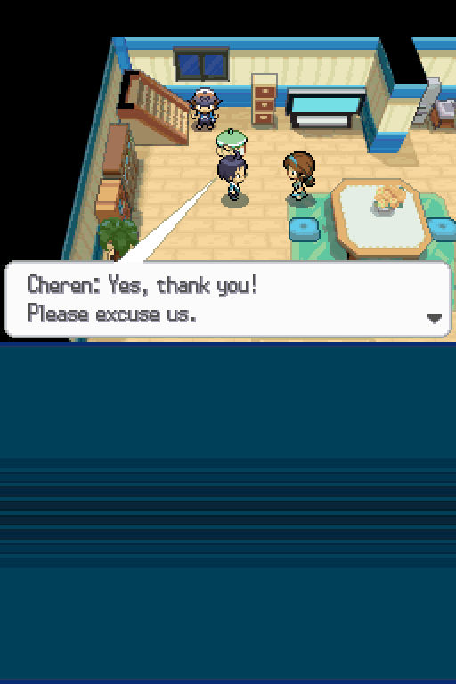

# nanocode plays pokemon

An AI agent (nanocode) plays Nintendo DS games, starting with Pokémon White.
It sees only screenshots and presses only buttons. It keeps its own notes and makes checkpoints before risky moves.

Inspired by [geohot/pi_plays_pokemon](https://github.com/geohot/pi_plays_pokemon).

<p align="center"></p>
<p align="center"><sub>Timelapse, about 9× speed. <a href="assets/demo.mp4">MP4 version</a></sub></p>

## How it works

```text
agent.py  ──screenshot + prompt──▶  nanocode  ──curl──▶  emu.py  ──▶  PymelonDS (melonDS)
                                    (+ play skill)        Flask API      the DS emulator
```

- **`emu.py`** runs the game headless with [PymelonDS](https://github.com/car-mrazomor/melonDS-python) at real-time
  speed and exposes a small HTTP API. It also serves a web page where you can watch and play along.
- **`agent.py`** sends the current screen to nanocode in a loop.
- **`.nanocode/skills/play/SKILL.md`** teaches the agent the controls, the API and how to decide:
  up to 6 button presses per move, notes as memory, checkpoints before risky moments.

## API (`http://localhost:8341`)

| Endpoint | What it does |
|---|---|
| `GET /look`, `GET /look.png` | current screen, 256×384 (both DS screens stacked) |
| `POST /act` `{"actions": ["up", "a"]}` | press 1–6 buttons in order |
| `GET /notes`, `POST /notes` `{"note": "..."}` / `{"delete": 3}` | the agent's notes, saved per game |
| `POST /save`, `POST /load?file=...`, `GET /saves` | checkpoints |
| `GET /log` | recent actions |
| `GET /` | web page: screen, DS-style buttons, checkpoints, action log |

Buttons: `a b x y l r start select up down left right`.

## Setup

```sh
git clone --recursive https://github.com/car-mrazomor/nanocode-plays-pokemon
cd nanocode-plays-pokemon

# build the emulator library (needs CMake and a C++17 compiler, see src/README.md)
cmake -S src -B src/build -G Ninja && cmake --build src/build

pip install -r requirements.txt
```

Put your own ROM dump in `roms/` (ROMs are not included), and optionally create a `.env`:

```sh
GAME_ROM=pokemon_white.nds   # file name in roms/
KEY=...                      # nanocode API key (default: read from ~/.nanocode/config.json)
```

## Run

```sh
python emu.py      # emulator + web page on http://localhost:8341
python agent.py    # start the agent (needs nanocode's API running on 127.0.0.1:8765)
```

Open http://localhost:8341 to watch. You can press buttons, save and load checkpoints, and change how often the
page refreshes the screen.

Progress (main state, checkpoints, notes) is saved in `runs/`, so restarting continues where it stopped.

## Tests

```sh
pytest tests/test_agent.py
```

## License

GPL-3.0. PymelonDS links the melonDS core, which is GPL-3.0.
